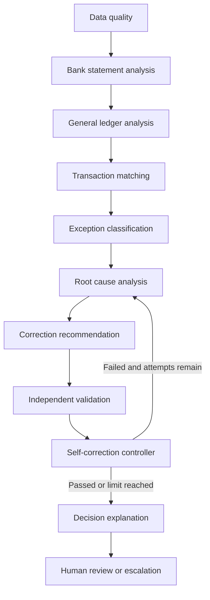

# Ten-agent architecture

The application now runs ten separate specialist implementations as actual LangGraph nodes. Each has its own input interpretation and Pydantic-validated output, and every completed node records its output, iteration and duration. Facts are distinguished as deterministic, mock or LLM-derived.

1. Data Quality inspects scoped canonical records and actual import quality reports.
2. Bank Statement Analysis interprets source codes through the tenant dictionary.
3. General Ledger Analysis recalculates journal groups and finds duplicate candidates.
4. Transaction Matching reviews actual matching evidence and scoped alternative candidates; it cannot override constraints.
5. Exception Classification produces the observed category, severity and financial exposure.
6. Root Cause Analysis uses a structured taxonomy, alternatives and uncertainty. Mock mode uses evidence rules; the optional OpenAI provider returns a typed Diagnosis.
7. Correction Recommendation produces a typed draft or manual-review action, including target/current/proposed values, risk, impact, posting date and approval requirement.
8. Independent Validation separately normalizes original source values and verifies accounting, evidence, account, policy and period invariants.
9. Self-Correction Controller evaluates actual findings, revisits root cause/recommendation when permitted, and stops at the proposal limit.
10. Decision Explanation reports remaining uncertainty and explicitly separates validation from real resolution.

The ten components are in `backend/app/agents/specialists.py`; graph construction is in `orchestration.py`. Mock mode uses deterministic evidence and explicitly labeled mock recommendations. It does not pretend to be paid LLM reasoning. The OpenAI root-cause and correction adapters are implemented, with structured parsing and one bounded read-only evidence tool. Tools cannot access other exceptions, alter records, approve changes or post journals. Offline provider tests validate tool boundaries; no paid calls were made.

Node checkpoints commit independently of final proposal persistence. Recovery resumes from the next recorded node if context and policy still agree. Changed context requires a fresh run. A three-attempt correction ceiling, graph recursion ceiling, workflow deadline checks and provider request timeouts bound execution. Durable tasks have leases and at most three claims; exhausted or abandoned tasks escalate. An in-flight provider request is bounded by its SDK timeout, not forcibly interrupted by the graph.

Provider interface patterns follow the official [Structured Outputs](https://developers.openai.com/api/docs/guides/structured-outputs?api-mode=chat) and [function calling](https://developers.openai.com/api/docs/guides/function-calling) guides. Live provider behavior remains unverified without configured credentials.
