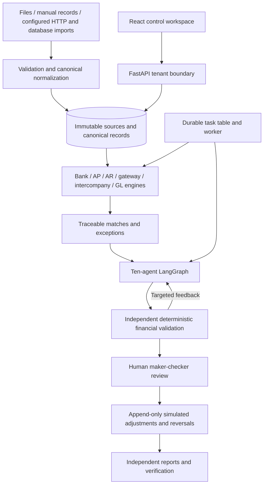
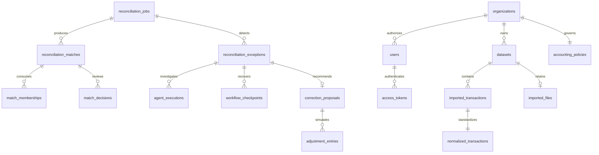

# Architecture and persistence

There are 25 relational tables. Initial operational tables hold organizations, users, datasets, immutable source transactions, reconciliation jobs/matches/exceptions, correction proposals, reflections, adjustments and audits. Extended tables hold accounts, versioned accounting policies, normalized transactions, original files, unique match membership, append-only match decisions, agent executions, checkpoints, tasks, mapping templates, expiring access tokens, model artifacts and shared rate counters and case ownership/resolution state.

Foreign keys and uniqueness enforce scope references, transaction identity per dataset, one proposal per exception, transaction membership per job, operation idempotency and one reversal per adjustment. Mutable workflow/configuration state is audited. Source rows, canonical records, original files, agent executions, checkpoints, decisions, reflections, adjustments and audits are append-only through ORM guards and migration-installed database triggers where applicable.

Money uses Decimal calculations and PostgreSQL NUMERIC(24,6); SQLite stores decimal text to avoid binary float affinity. Application aggregation never uses SQLite SUM on monetary text. Evidence and structured records use PostgreSQL JSONB, with JSON on SQLite. Core business relationships and match consumption are normalized; detailed agent facts and proposed values remain validated JSON rather than redundant entity tables.

Synchronous routes remain available. POST /tasks submits durable asynchronous reconciliation or investigation; `python -m app.worker` atomically claims work with a lease, persists results and bounds retries. PostgreSQL row locks protect financial mutations; local SQLite uses process coordination and database uniqueness. Production multi-worker behavior must be verified against PostgreSQL, not inferred from SQLite tests.
