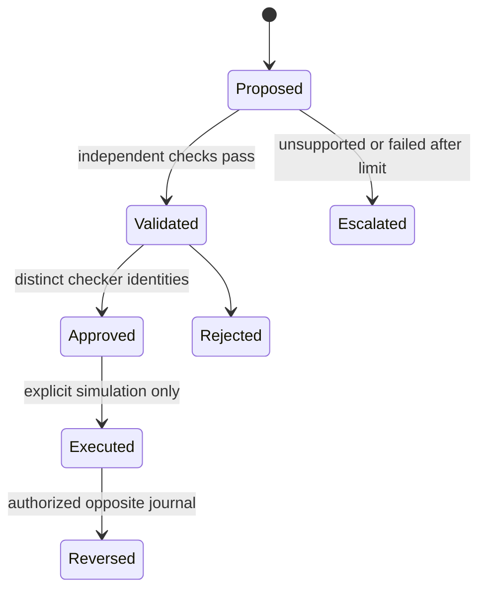

# Security and financial controls

The default mode is recommendation-only. Simulation must be enabled explicitly. There is no ERP posting tool accessible to an agent. Corrections are typed proposals; validation, approval, execution and external resolution are separate states.

Bootstrap creates separate analyst, checker, second-checker and administrator identities. Random bearer tokens are stored hashed and expire after eight hours. Rotation revokes old grants. Indefinite legacy user hashes are disabled by default and enabled only in controlled test fixtures. The local operator renewal command is `python -m app.issue_access --name NAME --org-id ID`; it writes credentials to the ignored private local file, never logs them.

All business reads and writes are tenant-scoped. Role checks separate analysts and approvers. Administrators cannot approve their own proposals. High-value adjustments require two distinct checkers. Every approval/execution revalidates the current tenant policy, accounts and closed period. Policy changes make older proposal versions ineligible. Reversals also check the current period. Unique operation keys are bound to the proposal and operation; original records are never overwritten or silently deleted.

Uploads are limited to ten MB and ten thousand records, with restricted formats, unique headers and a fifty MB expanded XLSX limit. HTTP request Content-Length is capped at eleven MB; Nginx additionally enforces body size. Original binaries are retained with SHA-256 and can optionally use AES-256-GCM through FILE_ENCRYPTION_KEY. REQUIRE_FILE_ENCRYPTION enforces that configuration. Protect database volumes, canonical JSON and backups with infrastructure-level encryption; binary encryption does not encrypt every database field. Authenticated masked transaction reads omit raw records.

Shared database rate limiting is available and enabled by Compose. TLS is a deployment responsibility. Logs omit raw financial records, provider payloads and bearer tokens. Source files and descriptions are untrusted; providers receive scoped facts and cannot request arbitrary URLs, SQL, other-tenant evidence or execution tools. Configured HTTP imports disable redirects; database imports use a fixed read-only export view.

Retention duration is recorded in tenant policy. Original financial/audit records remain immutable; archival, legal holds, backup deletion and infrastructure retention must be operated under the organization's policy. No silent automated financial deletion is implemented.

## Token-free local demo access

At the user's request, Start-Local.ps1 enables LOCAL_DEMO_MODE for the explicitly resolved local organization. Loopback client/Host and local-origin checks gate this mode. The UI opens directly and offers an explicit demo identity selector. It does not authenticate real human identities and is for the local demo only. Role checks and maker-checker identity separation still execute. Remote requests, foreign origins/Host values, manual server startup and Docker retain token authentication by default. Use -TokenAuth on the launcher to disable this convenience.
